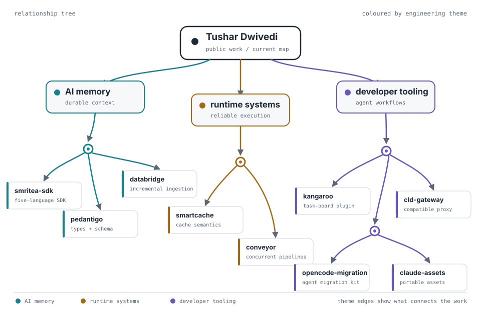

# Tushar Dwivedi

### I build systems that remember, recover, and keep moving.

Founder building [Smritea](https://smritea.ai/) and a hands-on staff engineer across
distributed systems, AI infrastructure, data platforms, and developer tools.
I like software that stays understandable after it meets production.

<picture>
  <source media="(prefers-color-scheme: dark)" srcset="./assets/topology-dark.svg">
  <source media="(prefers-color-scheme: light)" srcset="./assets/topology-light.svg">
  
</picture>

## Find me

- **Essays, experiments, and direct contact** —
  **[tushardwivedi.com](https://tushardwivedi.com/)**
- **Professional history and engineering network** —
  **[LinkedIn](https://www.linkedin.com/in/tushar-dwivedi/)**
- **Systems software from the workbench** —
  **[bytonomics.com](https://bytonomics.com/)**
- **Deep dives into durable memory** —
  **[Smritea Blog](https://blog.smritea.ai/)**
- **Developer essays in the open** —
  **[DEV Community](https://dev.to/tushar_bytonomics)**

## Selected systems

- **Memory APIs across five languages** —
  **[SmrutAI/smritea-sdk](https://github.com/SmrutAI/smritea-sdk)**, one SDK surface
  for durable AI memory in Python, TypeScript, Go, Java, and C#.

- **Typed validation for structured outputs** —
  **[SmrutAI/pedantigo](https://github.com/SmrutAI/pedantigo)**, with Go validation and
  JSON Schema generation for APIs, tools, and streamed LLM output.

- **Incremental pipelines for messy knowledge** —
  **[SmrutAI/databridge](https://github.com/SmrutAI/databridge)**, with parsing,
  deduplication, chunking, and embedding across local and cloud sources.

- **Caching with explicit failure semantics** —
  **[Bytonomics/smartcache](https://github.com/Bytonomics/smartcache)**, with stampede
  protection, negative caching, telemetry, and pluggable backends for Go.

- **Conversation state behind compatible APIs** —
  **[Bytonomics/cld-gateway](https://github.com/Bytonomics/cld-gateway)**, an
  Anthropic-compatible gateway for Codex-backed development workflows.

- **Portable workflows for coding agents** —
  **[tushar2708/claude-assets](https://github.com/tushar2708/claude-assets)**, with reusable
  skills, plugins, and workflows across Claude Code and Codex.

## Current signals

### Build

<!-- PROFILE:BUILD:START -->
- **[Bytonomics/cld-gateway — cld-gateway-v1.1.5](https://github.com/Bytonomics/cld-gateway/releases/tag/cld-gateway-v1.1.5)** 2026-09-05
- **[SmrutAI/pedantigo — v2.1.3](https://github.com/SmrutAI/pedantigo/releases/tag/v2.1.3)** 2026-09-03
<!-- PROFILE:BUILD:END -->

### Write

<!-- PROFILE:WRITE:START -->
- **[The Smritea plugin: persistent memory for Claude Code and Cursor](https://blog.smritea.ai/claude-code-and-cursor-plugin)** Smritea Blog · 2026-10-23
- **[Give any MCP client memory with the Smritea MCP server](https://blog.smritea.ai/mcp-server)** Smritea Blog · 2026-10-20
- **[Smritea search methods and rerankers: which to pick](https://blog.smritea.ai/search-methods-and-rerankers)** Smritea Blog · 2026-10-15
<!-- PROFILE:WRITE:END -->

Generated from published GitHub releases and the Smritea/DEV RSS feeds.
[Read the updater](./scripts/update_activity.py) ·
[View refresh runs](https://github.com/tushar2708/tushar2708/actions/workflows/update-profile.yml)
