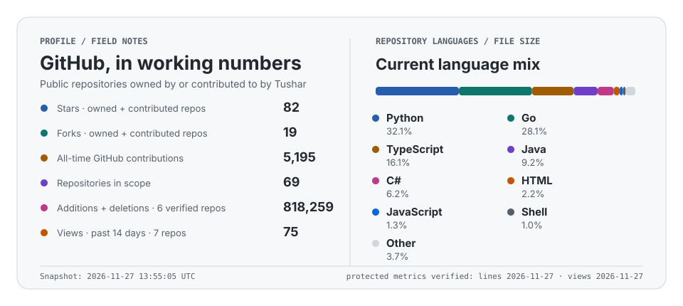

<picture>
  <source media="(prefers-color-scheme: dark)" srcset="./assets/banner-dark.svg">
  <source media="(prefers-color-scheme: light)" srcset="./assets/banner-light.svg">
  
</picture>

## GitHub field notes

<picture>
  <source media="(prefers-color-scheme: dark)" srcset="./assets/stats-dark.svg">
  <source media="(prefers-color-scheme: light)" srcset="./assets/stats-light.svg">
  
</picture>

Refreshed daily from GitHub’s API. Metrics requiring organisation-level access remain visibly unavailable until the profile statistics token is configured.

## Relationship tree

<picture>
  <source media="(prefers-color-scheme: dark)" srcset="./assets/topology-dark.svg">
  <source media="(prefers-color-scheme: light)" srcset="./assets/topology-light.svg">
  
</picture>

## Find me

- **Essays, experiments, and direct contact** —
  **[tushardwivedi.com](https://tushardwivedi.com/)**
- **Professional history and engineering network** —
  **[LinkedIn](https://www.linkedin.com/in/tushar-dwivedi/)**
- **Systems software from the workbench** —
  **[bytonomics.com](https://bytonomics.com/)**
- **Deep dives into durable memory** —
  **[Smritea Blog](https://blog.smritea.ai/)**
- **Developer essays in the open** —
  **[DEV Community](https://dev.to/tushar_bytonomics)**

## Systems behind the tree

### AI memory

- **Memory APIs across five languages** —
  **[SmrutAI/smritea-sdk](https://github.com/SmrutAI/smritea-sdk)** gives applications one SDK surface for durable AI memory in Python, TypeScript, Go, Java, and C#.
- **Typed validation for structured outputs** —
  **[SmrutAI/pedantigo](https://github.com/SmrutAI/pedantigo)** brings Go validation and JSON Schema generation to APIs, tools, and streamed LLM output.
- **Incremental pipelines for messy knowledge** —
  **[SmrutAI/databridge](https://github.com/SmrutAI/databridge)** parses, deduplicates, chunks, and embeds data across local and cloud sources.

### Runtime systems

- **Caching with explicit failure semantics** —
  **[Bytonomics/smartcache](https://github.com/Bytonomics/smartcache)** provides stampede protection, negative caching, telemetry, and pluggable Go backends.
- **Concurrent pipelines with visible flow** —
  **[tushar2708/conveyor](https://github.com/tushar2708/conveyor)** is a Go pipeline library for coordinated nodes, joints, and execution paths.

### Developer tooling

- **A task board inside Claude Code** —
  **[Bytonomics/kangaroo](https://github.com/Bytonomics/kangaroo)** turns agent work into a usable, local project board.
- **Conversation state behind compatible APIs** —
  **[Bytonomics/cld-gateway](https://github.com/Bytonomics/cld-gateway)** is an Anthropic-compatible gateway for Codex-backed development workflows.
- **Moving agent workflows into OpenCode** —
  **[SmrutAI/opencode-migration](https://github.com/SmrutAI/opencode-migration)** carries a deliberate migration path for tools, context, and habits.
- **Portable workflows for coding agents** —
  **[tushar2708/claude-assets](https://github.com/tushar2708/claude-assets)** packages reusable skills, plugins, and workflows for Claude Code and Codex.

## Current signals

### Build

<!-- PROFILE:BUILD:START -->
- **[Bytonomics/cld-gateway — cld-gateway-v1.1.5](https://github.com/Bytonomics/cld-gateway/releases/tag/cld-gateway-v1.1.5)** 2026-09-05
- **[SmrutAI/pedantigo — v2.1.3](https://github.com/SmrutAI/pedantigo/releases/tag/v2.1.3)** 2026-09-03
<!-- PROFILE:BUILD:END -->

### Write

<!-- PROFILE:WRITE:START -->
- **[The Smritea plugin: persistent memory for Claude Code and Cursor](https://blog.smritea.ai/claude-code-and-cursor-plugin)** Smritea Blog · 2026-10-23
- **[Give any MCP client memory with the Smritea MCP server](https://blog.smritea.ai/mcp-server)** Smritea Blog · 2026-10-20
- **[Smritea search methods and rerankers: which to pick](https://blog.smritea.ai/search-methods-and-rerankers)** Smritea Blog · 2026-10-15
<!-- PROFILE:WRITE:END -->

Generated from published GitHub releases, the Smritea/DEV RSS feeds, and the
[profile updater](./scripts/update_activity.py). ·
[View refresh runs](https://github.com/tushar2708/tushar2708/actions/workflows/update-profile.yml)
